<p align="center">
  <strong>简体中文</strong> · <a href="README.md">English</a>
</p>

<p align="center">
  
</p>

<h1 align="center">Easy Web Vibecoding</h1>

<p align="center">
  <strong>把 Claude Code、Codex、OpenCode 和 Shell 放进一个可恢复、可分屏的浏览器工作台。</strong>
</p>

<p align="center">
  <a href="https://github.com/DarranLiu/Easy-Web-Vibecoding/actions/workflows/tests.yml"></a>
  <a href="LICENSE"></a>
  
  
</p>

<p align="center">
  <strong>4</strong> 种终端 · <strong>4</strong> 格分屏 · 热更新 · 一键恢复原会话 · 桌面与移动端
</p>

Easy Web Vibecoding 的界面叫 **CC Terminal**。它不是新的模型服务，也不转发模型 API。它做的事情很直接：把服务器上已经能运行的命令行工具，通过 `tmux + FastAPI + xterm.js` 接到浏览器。

浏览器关掉、网络断开或 Web 后端重启，真正的任务仍留在 tmux 中。再次打开页面，就能继续看、继续输入。

**v0.2.0 新增：** 一键检测 CLI 版本、热更新共享安装、一键重启并恢复**原来的对话**。新版左侧工作区可以直接展开子窗口，切换与跨项目分屏不用挤在顶部标签栏。

> [!NOTE]
> 下面所有画面都来自项目真实前端和真实浏览器渲染。会话、目录、IP、文件和资源数据均为匿名演示内容，不对应任何真实服务器。

## 先跑起来

**Linux / 类 Unix 服务端**

```bash
git clone https://github.com/DarranLiu/Easy-Web-Vibecoding.git
cd Easy-Web-Vibecoding

export CC_WEB_ROOTS="$HOME/projects"
export CC_WEB_DEFAULT_DIR="$HOME/projects"
./run.sh
```

第一次运行会创建 `.venv`、安装 Python 依赖，并生成随机 Token。交互式终端会直接显示 Token；非交互式启动会把它写入权限为 `0600` 的 `~/.cc-web-token`，避免进入服务日志。默认只监听：

```text
http://127.0.0.1:8000
```

服务端需要 Python 3.10+ 和 `tmux`。Claude Code、Codex、OpenCode 需要先在服务器上自行安装并登录；本项目不会保存它们的 API Key。

完整部署方式见 [部署与配置](docs/DEPLOYMENT.md)。

## 新增 · 热更新与一键恢复原有交互终端

点顶部包裹图标打开“版本与更新”，同时看到**当前窗口、共享安装、官方最新**三个版本。网页与同一系统用户的 SSH 终端共用安装，不再各用一套旧程序。

| 操作 | 实际会发生什么 |
| --- | --- |
| 检测最新版本 | 查询官方发布信息，不安装、不重启。 |
| 仅更新 | 校验并切换共享安装；现有窗口继续运行原进程，之后新开的网页和 SSH 终端使用新版。 |
| 更新并恢复 | 安装新版，再只重启选中的窗口，校验原对话是否真正加载。 |
| 重启并恢复 | 不安装更新，直接重启所选程序并回到已记录的原会话。 |
| 回退安装 | 有可用备份时回到上一个安装版本；不会回滚聊天数据。 |

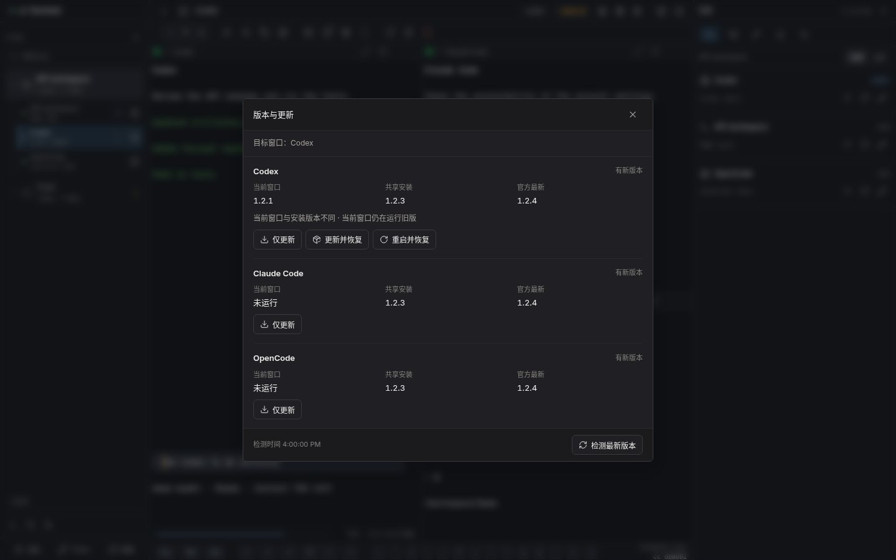

支持 **Codex、Claude Code、OpenCode**，也支持在网页 Shell 中以受支持方式启动的程序。恢复前会确认原会话 ID、程序、启动参数和目标进程；不能可靠识别时，会阻止重启或要求绑定确切的原会话，不会用“最近一条”碰运气。

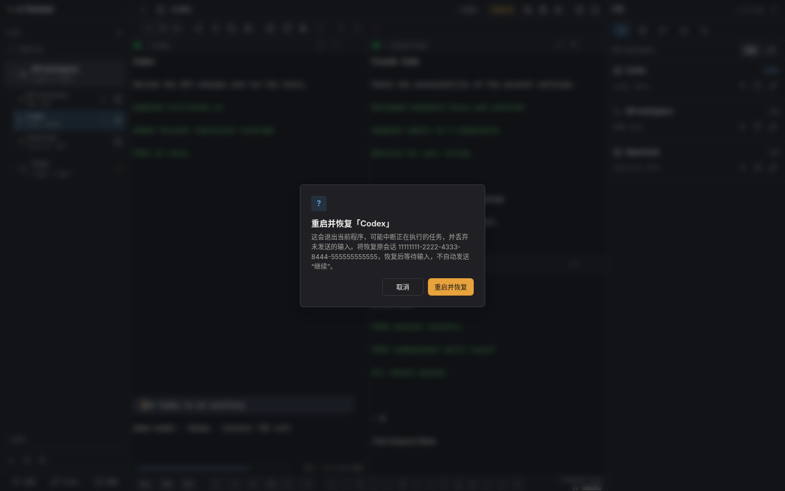

> [!IMPORTANT]
> 热更新指**替换安装而不停掉正在运行的进程**，不是让旧进程原地变成新版。重启可能打断当前任务、丢失未发送输入；恢复聊天记录不等于恢复正在执行的命令，也不能恢复服务器重启前的内存。其它终端不会一起重启。具体边界与升级步骤见 [更新与恢复说明](docs/UPDATES.md)。

## 01 · 从目录启动任何一种终端

点“新终端”，选项目目录，再选择 Claude 新对话、继续会话、Codex、OpenCode 或普通 Shell。没有安装的工具不会显示成一个点了才报错的假入口。

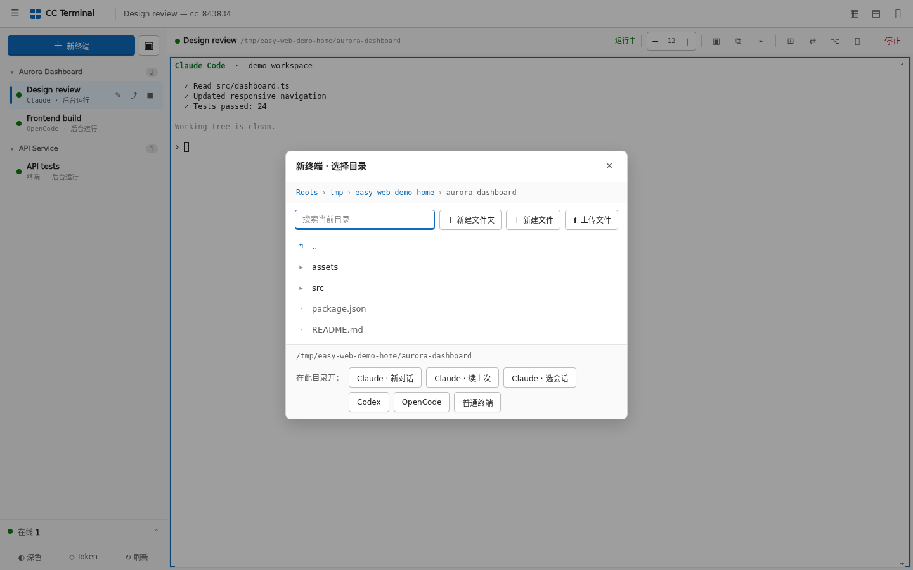

## 02 · 一个页面同时盯住多个任务

每个终端背后都是独立 tmux session。点左侧工作区展开子窗口，单击聚焦，点子窗口的分屏图标直接加入分屏，也能跨项目选择。切换工作区只改变导航，不改变屏幕上已经打开的终端。最多四格，支持拖动分隔线和交换位置；手机与电脑分别保存布局。

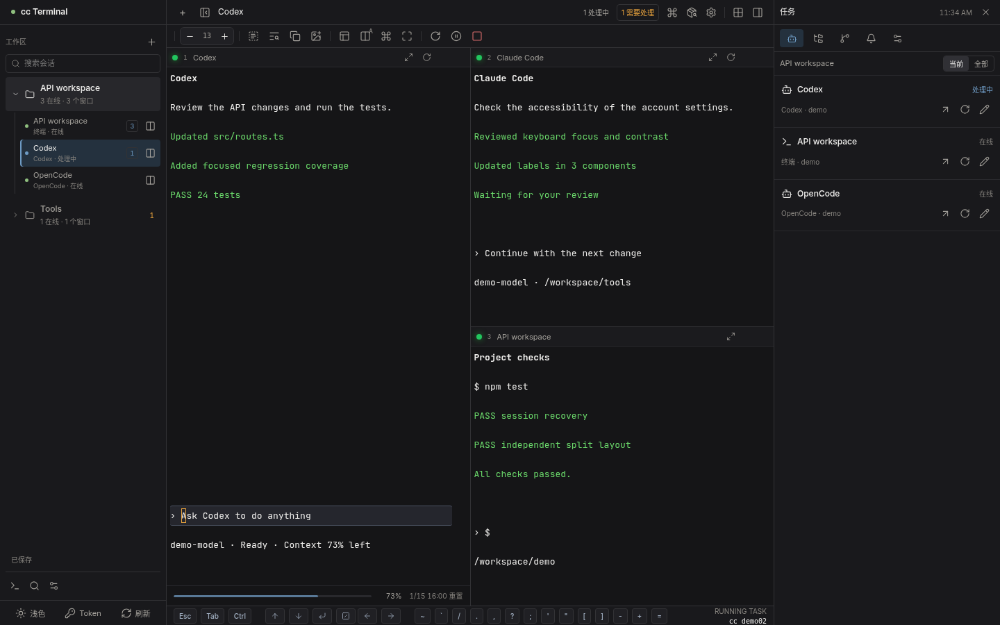

## 03 · Ctrl+C 只复制，中断单独确认

网页终端里的 `Ctrl+C`、`Ctrl+Shift+C`、Mac `Cmd+C` 现在**只复制选中文字**。没有选区或复制失败，也不会意外中断 Codex、CC 或 Shell。需要取消当前命令时，点工具栏“中断当前程序”并确认；“停止”仍然是在确认后终止整个 tmux 会话。

没有选区时，复制按钮会复制当前屏幕；长按或右键复制按钮会复制完整历史。对于会接管鼠标的 AI TUI，可以先打开顶部“选择模式”再拖动。

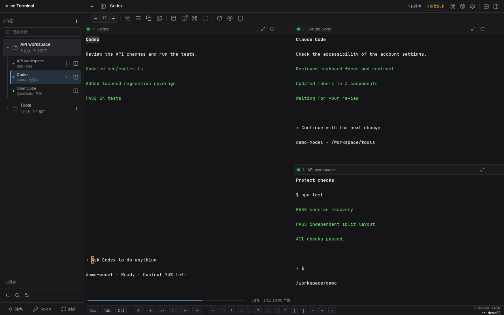

普通文字粘贴不需要专门窗口：聚焦终端后直接按 `Ctrl+V` / `Cmd+V`，或使用手机系统的粘贴操作即可。

## 04 · 粘贴图片不是一句空话

点顶部图片按钮后，可以选择图片、按 `Ctrl+V` 粘贴截图，或直接拖进窗口。图片会先保存到当前工作目录的 `.cc-web-images/`，随后把文件路径插入终端；补充一句要求再按回车即可。

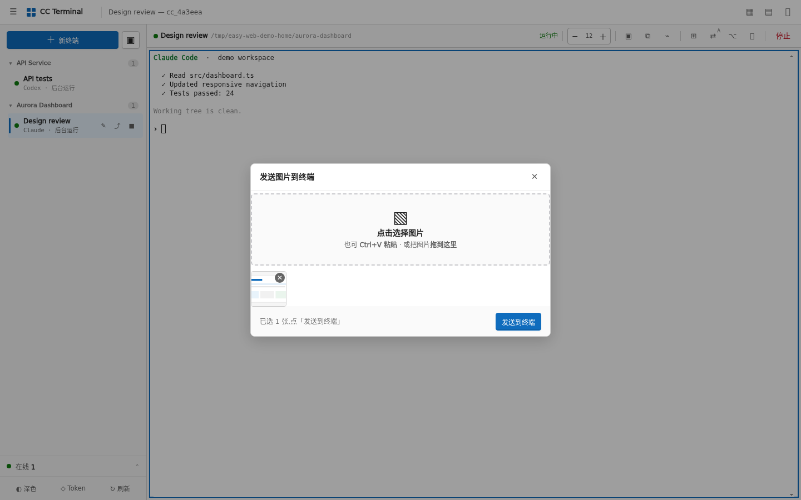

这样做不会把二进制数据硬塞进 PTY，也不会依赖某一家 AI 工具的私有上传接口。

## 05 · 文件管理不必再开一个远程桌面

文件面板支持列表/网格、筛选、上传、下载、新建、改名和删除。所有操作都受 `CC_WEB_ROOTS` 白名单限制。

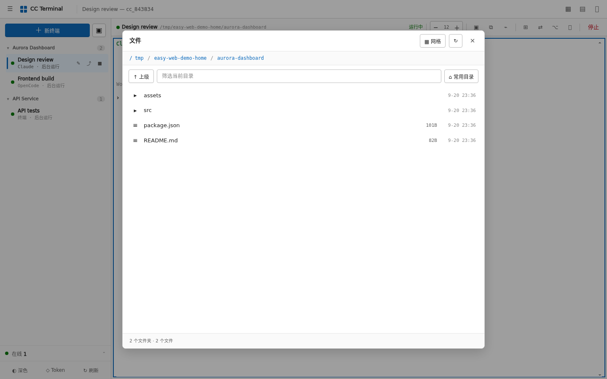

图片、视频、音频、PDF 和常见文本可以直接预览，并支持前后切换与下载。

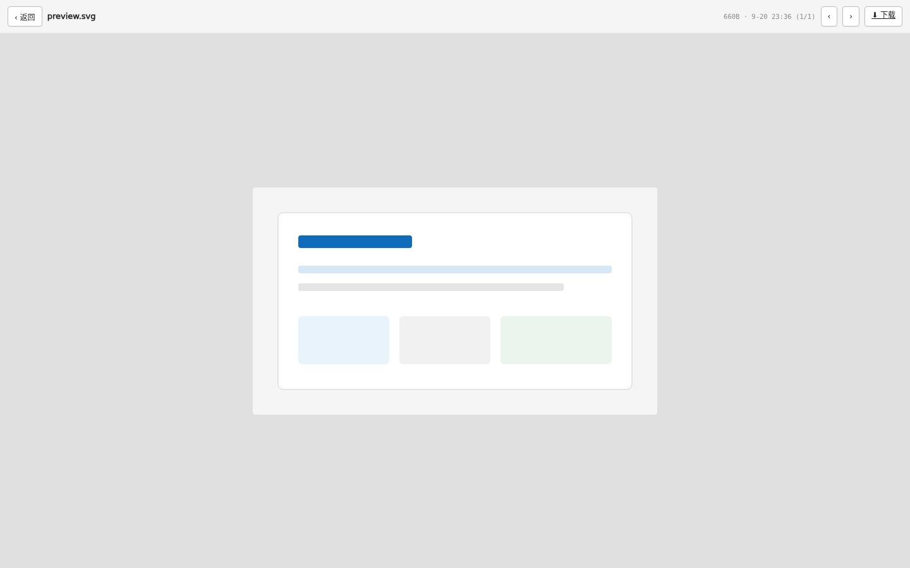

工作区文件面板还能编辑不超过 512 KiB 的 UTF-8 文件，保存时检查冲突并保留权限。Git 面板只读查看分支、修改和差异，不会替你暂存或提交。

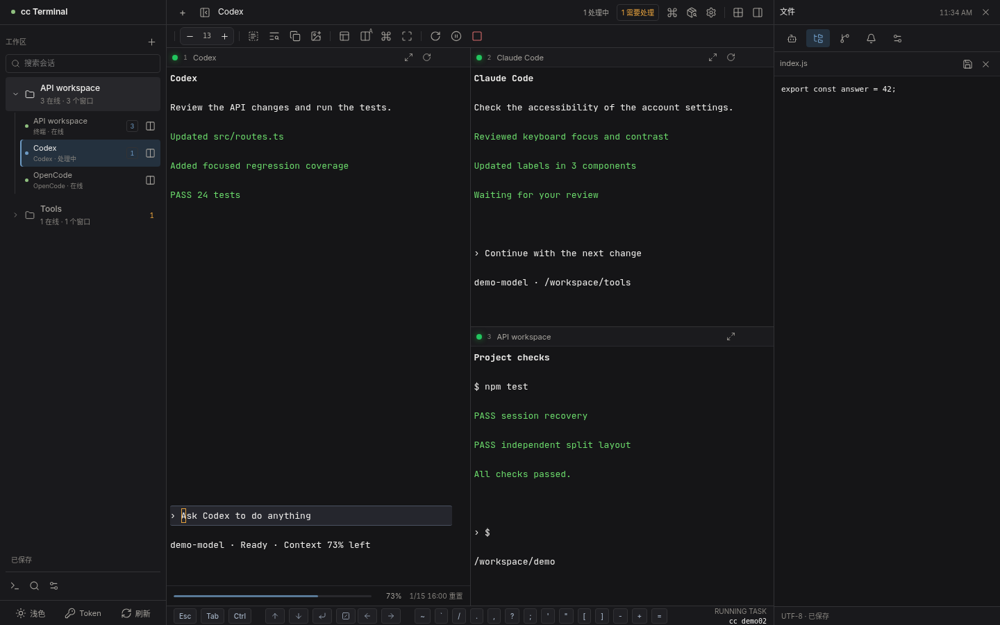

## 06 · GPU 和磁盘放在同一个资源面板

GPU 页展示显存、利用率、温度、功耗、用户和进程名。它不会采集完整命令参数，避免参数里的 Token 或私人路径进入面板。远程主机可通过免密 SSH 读取 `nvidia-smi`，无需在远端安装本项目。

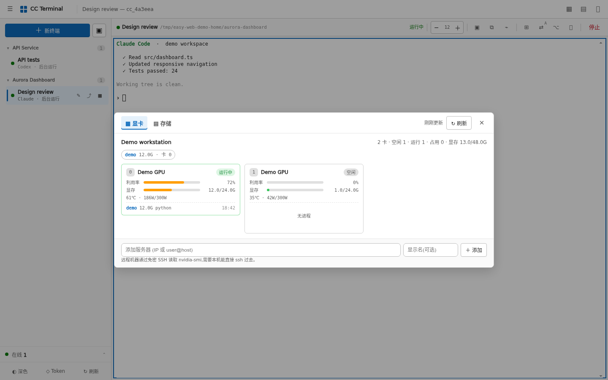

存储页先看分区容量，再按目录逐层下钻。耗时的 `du` 在后端扫描并缓存，不会把页面一直卡住。

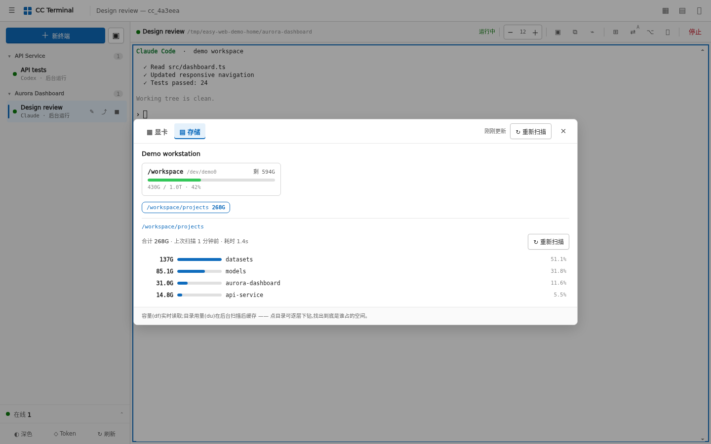

## 07 · 连接管理，而不是假装有一套账号系统

当前版本使用共享 Token，不是多租户账号/角色系统。它提供的是更实用的连接识别：查看通过认证的来源 IP、设备、首次/最近出现时间和访问次数，可以加备注、标记可疑或删除记录。

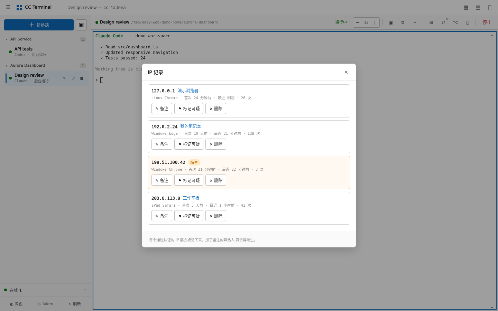

未备注的新来源会显示为“陌生”并亮起提醒。这个面板是辅助监控，不替代反向代理、身份访问控制或防火墙。

## 08 · Codex 用量只在需要时出现

只有当前聚焦的 Codex 窗口会在底部显示一条轻量用量栏：剩余百分比与重置时间。后台标签、其它分屏和其它工具不会重复请求；多个入口共享缓存和文件锁，服务端最多每 10 分钟读取一次。

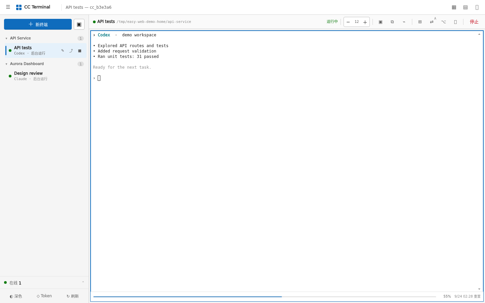

## 09 · 手机上仍然是终端，不是缩小的桌面网页

移动端保留 `Esc`、`Tab`、`Ctrl`、方向键、回车等辅助键。点标题展开最近会话，点斜杠菜单选择对应工具支持的 `/model`、`/fast` 等原生命令；只填命令，不自动回车。配合方向和确认键，不打开软键盘也能操作原生菜单。滑动查看历史，先按住再拖动才选择文字。

<p align="center">
  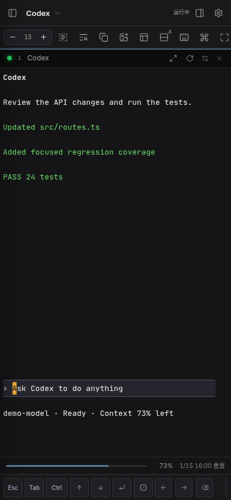
</p>

<p align="center">
  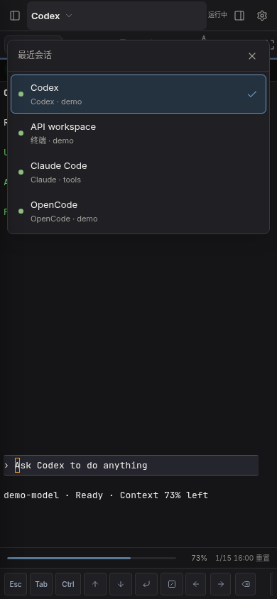
  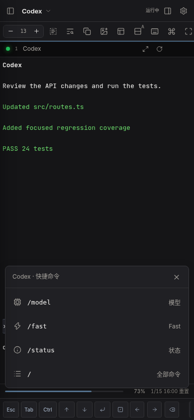
</p>

## 外观 · 保留原生输入，不再加一层输入框

默认石墨色，可选雾色玻璃、边缘流光、光标拖尾和淡色原生输入区。深浅色、手机、减少动态效果、省流和系统高对比度都有对应退化方式。动效不修改终端输出，也不请求模型 API。

## 10 · 断线、刷新、滚轮和字体这些细节也算功能

- 浏览器断开只会分离 tmux 客户端，不会杀任务。
- 内联终端使用 tmux 历史；全屏 Codex 使用细粒度原生滚轮，不再整页跳动或停留在旧屏幕快照。
- 终端字体随项目自带，减少 Windows 客户端缺字、方框和特殊符号错位。
- 中文输入法按 composition 生命周期处理，避免把合成中的文字拆成按键。
- 页面支持浅色/深色、高对比度、减少动画和可安装 Web App 布局。
- 慢速网络使用有界输出队列和背压，避免无限积压终端输出。

这些问题为何出现、最后怎样处理，见 [曾经解决过的问题](docs/PROBLEMS_SOLVED.md) 和 [v0.2.0 更新说明](docs/releases/v0.2.0.md)。

## 操作手册

[可视化操作手册](docs/VISUAL_GUIDE.md) 按实际点击顺序说明：

- 新建与恢复终端
- 分屏、切换、交换和关闭
- 滚动历史、选择、复制与粘贴
- 粘贴截图或拖入图片
- 文件管理与预览
- GPU、磁盘与目录扫描
- 在线连接与 IP 记录
- Codex 用量与移动端操作

## 它是怎么工作的

```text
浏览器 xterm.js
      │ WebSocket
      ▼
FastAPI 后端 ── attach ── tmux session ── Claude / Codex / OpenCode / Shell
      │
      └── 文件、资源、在线状态等 REST API
```

核心原则只有一个：**浏览器连接和终端进程不是一回事。**

## 常用配置

| 环境变量 | 默认值 | 人话说明 |
| --- | --- | --- |
| `CC_WEB_HOST` | `127.0.0.1` | 服务监听地址。不要直接暴露到公网。 |
| `CC_WEB_PORT` | `8000` | 服务端口。 |
| `CC_WEB_AUTH` | `1` | 是否启用 Token 登录。只有纯本机调试才能设为 `0`。 |
| `CC_WEB_TOKEN` | 启动时随机生成 | 自定义登录 Token。建议使用长随机值。 |
| `CC_WEB_ROOTS` | 当前用户家目录 | 文件 API 可以访问的根目录，多个目录用逗号分隔。 |
| `CC_WEB_DEFAULT_DIR` | 当前用户家目录 | 新终端默认打开的位置。 |
| `CC_WEB_CLAUDE` | 自动查找 | `claude` 可执行文件路径。 |
| `CC_WEB_CODEX` | 自动查找 | `codex` 可执行文件路径。 |
| `CC_WEB_OPENCODE` | 自动查找 | `opencode` 可执行文件路径。 |
| `CC_WEB_DISK_ROOTS` | 当前用户家目录 | 资源面板允许执行 `du` 的目录。 |

更多环境变量、systemd 和 Caddy 示例见 [部署与配置](docs/DEPLOYMENT.md)。

## 安全边界

这不是普通网页。拿到访问权限的人，通常也就拿到了运行服务的系统用户权限，因此应该像保护 SSH 一样保护它。

- 保持 `CC_WEB_AUTH=1`。
- 公网访问必须使用 HTTPS，并建议再加一层身份访问控制或来源限制。
- 不要把 `CC_WEB_ROOTS` 直接设为 `/`。
- 不要提交 `.env`、Token、证书、日志和状态 JSON。
- 当前没有多租户隔离、角色权限和只读访客模式。
- 通过认证的人会共享终端、文件、资源和连接信息，只应把 Token 交给受信任的操作者。
- IP 与设备类型会保存在本机的私有状态文件中；可以在“IP 记录”里删除。
- 默认关闭 Uvicorn access log，避免文件 API 的绝对路径进入服务日志；外部代理启用日志时也应去掉查询参数。

登录成功后，原始 Token 会换成服务端签名、带有效期的 HttpOnly、SameSite 会话 Cookie，浏览器不保存原始 Token。Token 不进入下载链接、WebSocket URL、浏览器历史或代理访问日志。API 和文件预览响应禁止缓存，运行时状态文件统一使用 `0600`。详见 [安全策略](SECURITY.zh-CN.md)。

## 测试

```bash
python3 -m unittest discover -s tests -v
node --check frontend/app.js
bash -n run.sh
npm ci
npx playwright install chromium
npm run test:browser
```

## 开源协议

项目代码使用 [MIT License](LICENSE)。内置 xterm.js、Lucide 图标和字体遵循各自协议，详见 [THIRD_PARTY_NOTICES.md](THIRD_PARTY_NOTICES.md)。MIT 授权代码本身；项目名称和标识的使用边界另见 [TRADEMARKS.md](TRADEMARKS.md)。
